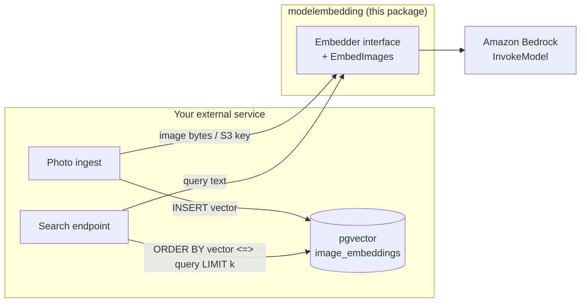

# modelembedding — Integration guide

`modelembedding` is a **thin SDK wrapper around Amazon Nova Multimodal
Embeddings** (`amazon.nova-2-multimodal-embeddings-v1:0`) on Amazon
Bedrock. It turns an image or a text query into a vector and returns it.
Storing vectors, deduplicating inputs, and running similarity search belong
to the caller, the same split `facev2` uses between the SDK and
`facev2/store`.

A working end-to-end example lives in
[`cmd/embeddingsmoketest`](../cmd/embeddingsmoketest/).

---

## 1. Architecture at a glance



| Concern | Owned by |
|---|---|
| Call Bedrock, build the Nova request, parse the vector | modelembedding |
| Retry throttling / temporary Bedrock failures | modelembedding |
| Run many images concurrently (`EmbedImages`) | modelembedding |
| Optional image preprocessing (`WithPreprocess`) | modelembedding |
| Dedupe (content hash), persist vectors, build the HNSW index | External service |
| Similarity search, filtering by event/folder, pagination | External service |

### Why the package doesn't insert into the database

- **Nova embeds one input per call.** The synchronous `InvokeModel` API
  accepts exactly one image or one text and returns one vector, so images
  are embedded one by one regardless of who writes them to the database.
- **The model call is the slow part.** In the smoke test, an image took
  about 0.4 s of wall-clock time at concurrency 4, and a text query took
  about 0.5 s. Inserting a 1024-dimension vector (4 KB) into pgvector takes
  about 1 ms. Doing that insert inside the package would save nothing
  measurable.
- **Returning a vector is free.** This is an in-process Go library, so
  "returning" means handing back a `[]float32`.
- **Throughput comes from concurrency.** `EmbedImages` runs several calls
  at once and retries throttling with backoff. Use `WithOnResult` to write
  each vector (or a batch of them) as soon as it is ready.
- **The schema is yours.** Table names, dimension, index type, and how
  rows are scoped (by event, album, or tenant) vary per service.

For large one-off backfills, Bedrock batch inference
(`CreateModelInvocationJob`) costs about 50% less but runs asynchronously
(minutes to hours), needs at least 100 records, an S3 bucket, and an IAM
service role. It is not wrapped by this package.

---

## 2. Setup

The module pins Bedrock Runtime and `golang.org/x/image` dependencies in
`go.mod`; no manual dependency installation is needed after checkout.
Verify the package without making billed AWS calls:

```bash
go build ./...
go test -race ./modelembedding -skip RealBedrock
go run ./cmd/embeddingsmoketest -h
```

```go
cfg, _ := config.LoadDefaultConfig(ctx, config.WithRegion(modelembedding.DefaultRegion)) // us-east-1
embedder := modelembedding.NewNovaEmbedder(bedrockruntime.NewFromConfig(cfg))
```

The IAM identity needs `bedrock:InvokeModel` on
`arn:aws:bedrock:us-east-1::foundation-model/amazon.nova-2-multimodal-embeddings-v1:0`.
Nova embeddings are only offered in some regions, so a Rekognition region
such as `ap-southeast-1` won't work. To use a cross-region inference
profile, call `NewNovaEmbedderWithModelId(client, "us.amazon.nova-2-multimodal-embeddings-v1:0")`.

---

## 3. SDK reference

```go
type Embedder interface {
    EmbedImage(ctx context.Context, image []byte, opts ...EmbedOption) (Embedding, error)
    EmbedImageWithBucket(ctx context.Context, s3Bucket string, s3Key string, opts ...EmbedOption) (Embedding, error)
    EmbedText(ctx context.Context, text string, opts ...EmbedOption) (Embedding, error)
}

type Embedding struct {
    Vector              []float32 `json:"vector"`
    Dimension           int       `json:"dimension"`
    ModelId             string    `json:"model_id"`
    Purpose             Purpose   `json:"purpose"`
    TruncatedCharLength *int      `json:"truncated_char_length,omitempty"` // text only
}
```

Every method makes exactly one Bedrock `InvokeModel` call (plus retries),
and never returns a partial result with a non-nil error.

### 3.1 `EmbedImage(ctx, image, opts...)`

Embeds raw image bytes. Call it once per photo at ingest time.

| Parameter | Meaning |
|---|---|
| `image` | JPEG, PNG, GIF, or WEBP bytes. The format is detected from the bytes. With `WithPreprocess`, BMP and TIFF are accepted too. Limit: 25 MB after base64 (about 18.7 MB raw). |
| `opts` | See §3.4. Purpose defaults to `GENERIC_INDEX`. |

Before calling Bedrock, it validates the input. Empty, oversized, or
unrecognized images fail immediately without an AWS call.

### 3.2 `EmbedImageWithBucket(ctx, s3Bucket, s3Key, opts...)`

Same as `EmbedImage`, but Bedrock reads the object from S3 (`s3://bucket/key`),
so the bytes never pass through your service. The S3 limit is 50 MB.

- The format comes from the key's extension (`.jpg`, `.jpeg`, `.png`,
  `.gif`, `.webp`); pass `WithImageFormat` when the key has none.
- `WithPreprocess` is ignored.
- The bucket must be in the same region as the Bedrock client, and the
  caller's identity needs `s3:GetObject` on it.

### 3.3 `EmbedText(ctx, text, opts...)`

Embeds a search query, up to 8,192 characters. Purpose defaults to
`IMAGE_RETRIEVAL`, which is the right choice for searching an index built
with `EmbedImage`. Over-long text is truncated at the end by default
(`TruncatedCharLength` reports where); use `WithTruncationMode(TruncateNone)`
to fail instead.

To embed text that is itself being *indexed* (captions, documents), pass
`WithPurpose(PurposeGenericIndex)`.

### 3.4 Options

| Option | Default | Applies to |
|---|---|---|
| `WithDimension(n)` | 1024 | all. Allowed: 256, 384, 1024, 3072. pgvector's HNSW index supports at most 2000, so 3072 can't be HNSW-indexed. |
| `WithPurpose(p)` | `GENERIC_INDEX` for images, `IMAGE_RETRIEVAL` for text | all |
| `WithImageFormat(f)` | detected | images |
| `WithDetailLevel(l)` | Nova's default, `STANDARD_IMAGE` | images. `DOCUMENT_IMAGE` reads text in images better; pair it with `PurposeDocumentRetrieval` queries. |
| `WithTruncationMode(m)` | `END` | text |
| `WithPreprocess()` / `WithPreprocessMaxSide(px)` | off / 1024 px | `EmbedImage` |

**Index and query must match.** Vectors are only comparable when they come
from the same model and the same dimension. Changing either means
re-embedding everything.

### 3.5 `EmbedImages(ctx, embedder, items, opts...)`

Embeds many images concurrently and returns one `ImageResult` per input,
in input order.

```go
results := modelembedding.EmbedImages(ctx, embedder, items,
    modelembedding.WithConcurrency(8),
    modelembedding.WithEmbedOptions(modelembedding.WithPreprocess()),
    modelembedding.WithOnResult(func(r modelembedding.ImageResult) {
        if r.Err == nil {
            batch = append(batch, r) // flush to the DB every N results
        }
    }),
)
```

| Behavior | Detail |
|---|---|
| Input | `ImageInput{ID, Image}` or `ImageInput{ID, S3Bucket, S3Key}`. `ID` is yours and is echoed back. |
| Concurrency | `WithConcurrency(n)`, default 4. Raise it only as far as your account's Bedrock requests-per-minute quota allows. |
| Per-item failures | One bad image doesn't stop the others; its `ImageResult.Err` is set. |
| Fatal failures | Rejected or expired credentials, `AccessDeniedException`, or `ResourceNotFoundException` (wrong model id or region) stop the run. Items not yet started get an error where `errors.Is(err, ErrAborted)` is true. |
| `WithOnResult` | Called once per item in completion order, never concurrently, so it can write to a DB without extra locking. |
| Cancellation | Unfinished items get the context's error. |

It works with any `Embedder`, including `StatsEmbedder` and test fakes.

### 3.6 Preprocessing

`WithPreprocess()` (or calling `PreprocessImage(data, maxSide)` directly):

1. Decodes JPEG, PNG, GIF (first frame), WEBP, BMP, or TIFF.
2. Applies the JPEG EXIF orientation. Go's decoder ignores it, so without
   this step phone photos would be embedded sideways.
3. Flattens transparency onto white.
4. Shrinks the image so its longest side is at most 1024 px. Smaller
   images are never enlarged.
5. Re-encodes it as JPEG (quality 90).

Nova charges per image regardless of size, so preprocessing doesn't change
cost. It reduces upload size and latency, and makes BMP and TIFF usable.
HEIC is not supported.

### 3.7 Errors and retries

| Error | Meaning | Behavior |
|---|---|---|
| `ErrEmptyInput`, `ErrInputTooLarge`, `ErrInvalidDimension`, `ErrUnsupportedImageFormat` | Rejected before calling Bedrock | Returned immediately |
| `ErrUnexpectedResponse` | Bedrock answered, but without a vector of the requested size | Returned immediately |
| `ThrottlingException`, `ServiceUnavailableException`, `InternalServerException`, `ModelNotReadyException`, `ModelTimeoutException` | Temporary | Retried up to 4 attempts with jittered backoff (about 1 s, 2 s, 4 s), on top of the AWS SDK's own quick retries |
| `ValidationException` | Bad input, such as a corrupt image | Returned immediately |
| `AccessDeniedException`, `ResourceNotFoundException` | IAM permission, or model not available in the region | Returned immediately; aborts `EmbedImages` |

AWS errors are wrapped with `%w`, so `errors.As` reaches them:

```go
var throttled *types.ThrottlingException // github.com/aws/aws-sdk-go-v2/service/bedrockruntime/types
if errors.As(err, &throttled) { ... }
```

### 3.8 Observability

- **Logs.** Every call emits an `slog` record with `op`, `purpose`,
  `dimension`, and `duration_ms`. It uses `slog.Default()` unless you call
  `modelembedding.SetLogger(l)`.
- **Call counting.** Wrap any `Embedder` in `NewStatsEmbedder` and read
  `.Snapshot()` for the number of Bedrock calls per method.

---

## 4. Suggested datastore schema (pgvector)

```sql
CREATE EXTENSION IF NOT EXISTS vector;

CREATE TABLE image_embeddings (
    image_id     TEXT PRIMARY KEY,
    event_id     TEXT NOT NULL,
    content_hash TEXT NOT NULL,          -- sha256 of the source bytes, to skip unchanged images
    model_id     TEXT NOT NULL,
    embedding    vector(1024) NOT NULL,  -- must match WithDimension
    created_at   TIMESTAMPTZ NOT NULL DEFAULT now()
);

CREATE INDEX ON image_embeddings USING hnsw (embedding vector_cosine_ops);
CREATE INDEX ON image_embeddings (event_id);

-- Search: embed the query with EmbedText, then
SELECT image_id, 1 - (embedding <=> $1) AS cosine
FROM image_embeddings
WHERE event_id = $2
ORDER BY embedding <=> $1
LIMIT 20;
```

Check `content_hash` before calling `EmbedImage`: Bedrock bills every
call, even for an image you've already embedded.

---

## 5. What embeddings are (and aren't) good for

Nova embeddings capture what a picture *shows*: a stage, a crowd, a
running race, "a bald man smiling". They are not an identity model. In the
smoke test, the query "Dwayne Johnson" ranked all four of his photos first,
but "Jason Statham" also ranked Dwayne Johnson's photos above Jason
Statham's. To find a specific person, use face matching (`facev2`), and
use embeddings for descriptive search.

Scores are raw cosine similarities. They are useful for ranking within one
model, but don't compare them across models or treat a fixed number as
"match".

---

## 6. Smoke test

```bash
go run ./cmd/embeddingsmoketest -env facev2/.env \
    -input ./cmd/input_image -query "a man in a suit" -query "Dwayne Johnson"
```

It embeds every image in the folder, prints each query's top results, and
prints an image-to-image similarity matrix and the Bedrock call count. The
region defaults to `us-east-1` regardless of `AWS_REGION` in the `.env`.

The package's own real-Bedrock test (`TestNovaEmbedder_RealBedrock`) reads
`modelembedding/.env` and is skipped when that file is absent.
